# Frontend architecture: apps/admin

An overview of the admin app as the code stands today: which pages exist, which components they
render, and where their data comes from. Everything here is read from the source; where the code
leaves something open, the text says so instead of filling the gap.

Each section comes in four levels. Level 1 is the quick overview and is always shown; Levels 2–4
are collapsed and add detail step by step, ending with the full diagram in Level 4.

Keep this file in step with the code (see `CLAUDE.md` → Conventions).

## Legend

The same colours are used in every diagram, at every level.

| Category      | Colour            | What it is                                                         |
| ------------- | ----------------- | ------------------------------------------------------------------ |
| Page          | blue              | A `page.tsx` or `not-found.tsx` in `app/`                          |
| Layout        | purple            | A `layout.tsx` in `app/`                                           |
| Component     | green             | A React component in `components/` (or `next/react` built-in)      |
| Zustand store | orange            | A Zustand store in `lib/`                                          |
| Mock data     | grey, dashed edge | A mock-data module in `lib/` that stands in for the Convex backend |

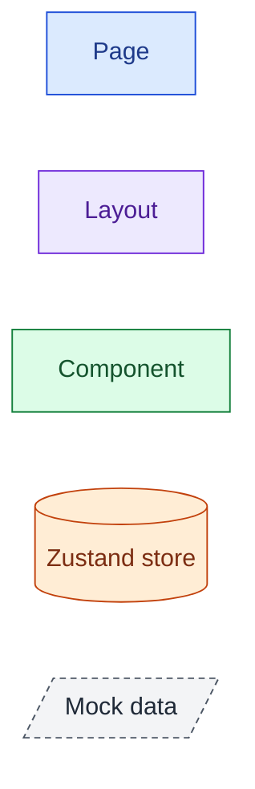

In the data-flow diagrams, solid arrows carry data down to where it is shown; dashed arrows carry
changes back up to the store.

## 1. Pages and routes

### Level 1

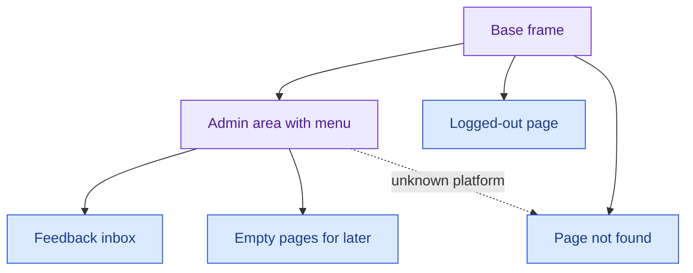

Every page sits in one base frame; the inbox and the empty pages also get the admin menu, while
the logged-out page does not. There is one page-not-found page: it shows the menu for an unknown
platform, and no menu for any other unknown address.

Level 2

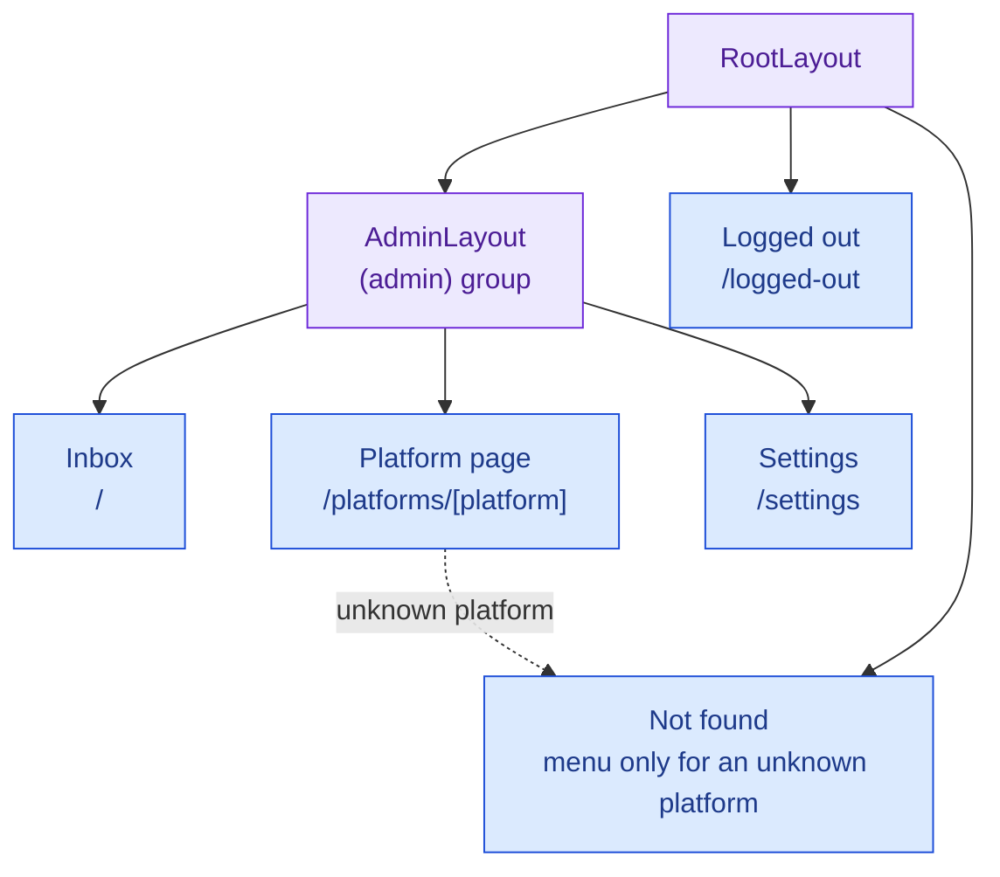

Level 3

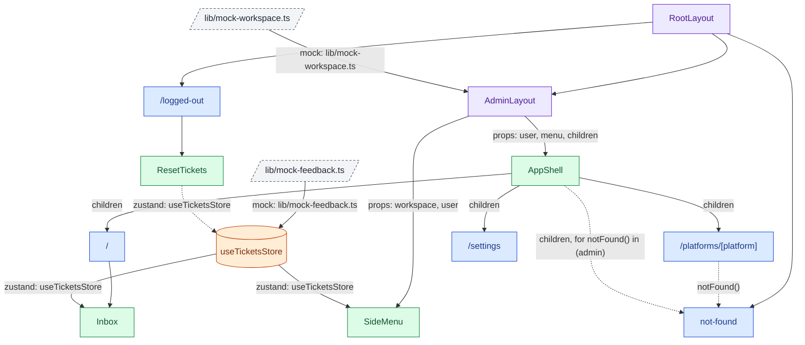

Level 4

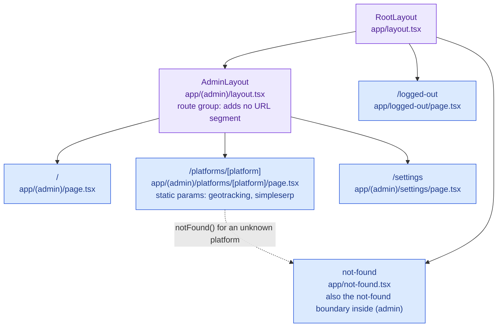

The `(admin)` route group decides whether a page gets the side menu: everything inside it is
wrapped by `AdminLayout` (and so by `AppShell` and `SideMenu`), while `/logged-out` sits directly
under `RootLayout` with no menu. There is one not-found page, `app/not-found.tsx`, and where it
renders depends on how it is reached. For unmatched URLs (e.g. `/foo`) it renders under
`RootLayout` only, without the menu. Because `(admin)` is a route group directly under `app/`,
Next.js also puts it as the not-found boundary inside `AdminLayout`, so `notFound()` from
`/platforms/[platform]` (which builds only `geotracking` and `simpleserp`) renders it inside the
admin frame, with the menu. This comes from Next.js, not from our code: the server HTML for
`/platforms/foo` leaves the menu out, but the page the browser renders has it.
`/platforms/[platform]` and `/settings` are placeholders with a heading only.

## 2. Component tree

### Level 1

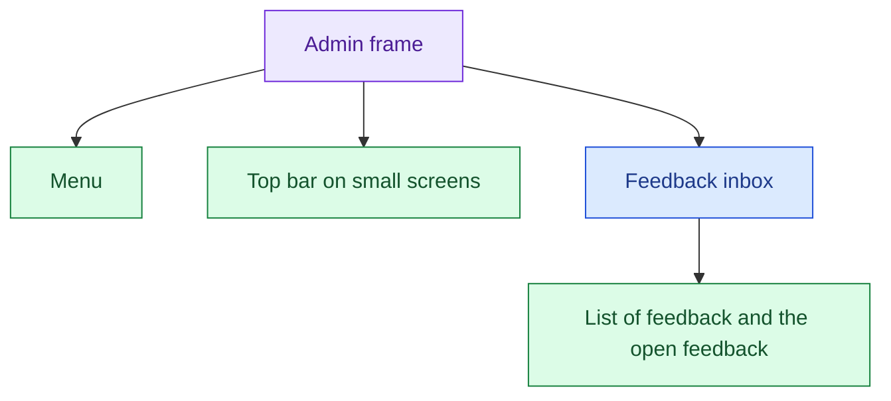

The admin frame puts a menu (and a top bar on small screens) around the page, and the inbox shows
a list of feedback next to the one that is open.

Level 2

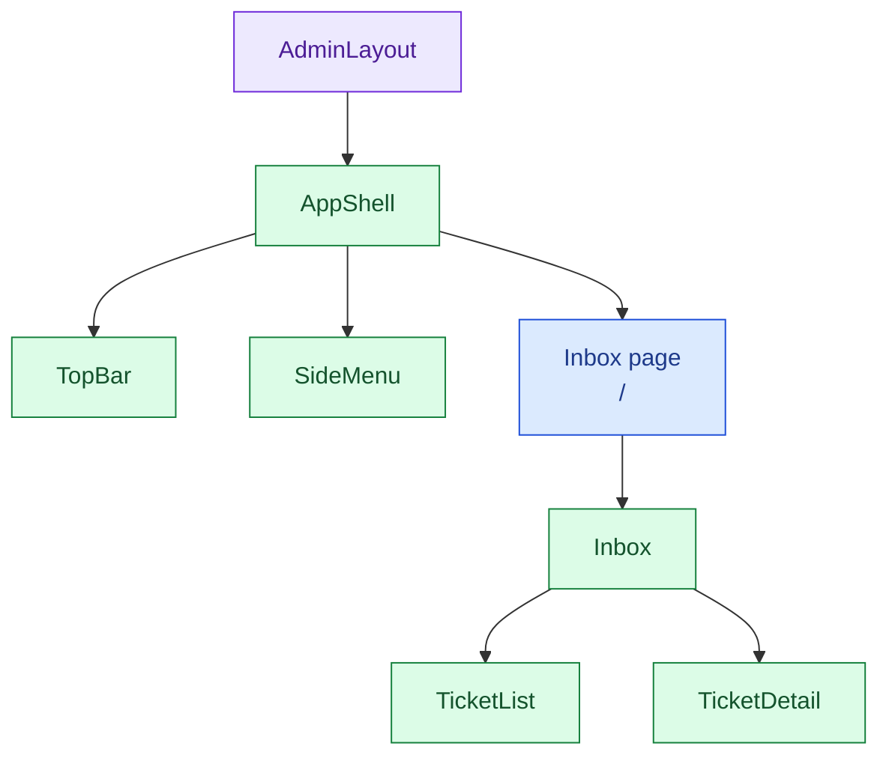

Level 3

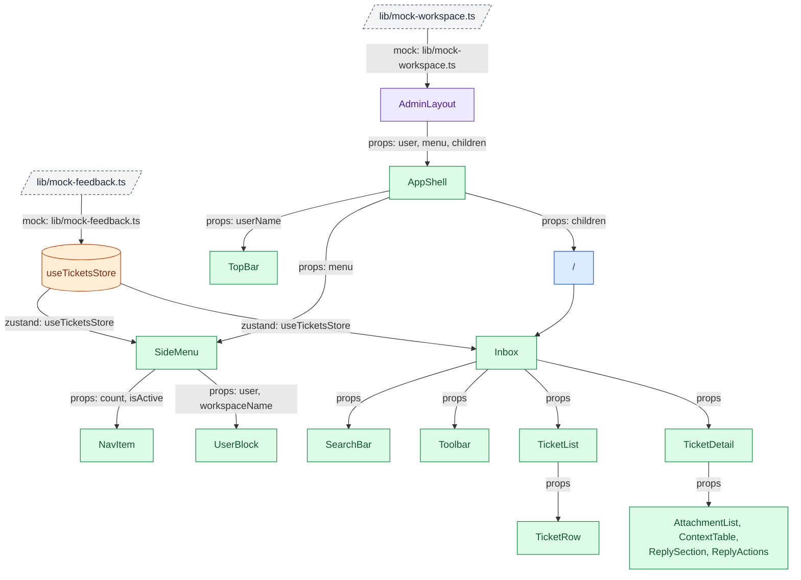

Level 4

Nesting is shown as parent → child. Icons are left out to keep the diagram readable. `Icon`
(`components/Icons/Icon.tsx`, an image from `public/icons`) is rendered by `AppShell`, `SideMenu`
(and its inner `PlatformIcon`), `UserBlock`, `UserAvatar`, `SearchBar`, `Toolbar`,
`AttachmentList`, `ContextTable` and `ReplyActions`. The inline SVG icons in `components/Icons`
take their size from the global `icon-size` class in `app/globals.css` and their dark colour from
the surrounding text (`currentColor`): `CategoryBadge` renders `BugIcon`, `LightbulbIcon` or
`MessageIcon` for the ticket's category, `TicketDetail` renders `BugIcon`, `TicketRow` renders
`PaperclipIcon` and `ReplyActions` renders `BranchIcon`; `ArrowLeftIcon` is not rendered yet.

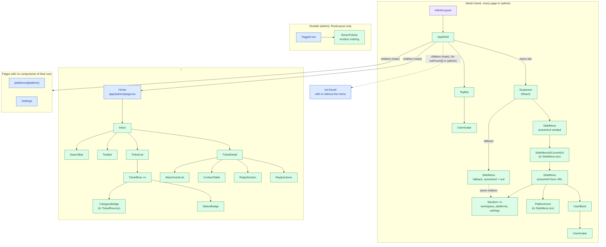

`SideMenu` renders itself up to three times: `AdminLayout` wraps it in `<Suspense>` because
`usePathname` can suspend on unknown platform URLs, so the fallback is the same menu with nothing
highlighted, and the real one hands off to `SideMenuAtCurrentUrl`, which reads the URL and renders
`SideMenu` again with `activeHref` set. The inbox is the only page with real UI; `Inbox` reads and changes
tickets through the store and keeps its own view state, while its children get props only, and
both `ReplySection` and `ReplyActions` are exported from the same file,
`components/inbox/ReplySection/ReplySection.tsx`. The placeholder pages and the not-found page
render only HTML and `next/link`; the not-found page renders inside `AppShell` for an unknown
platform and under `RootLayout` alone for any other unknown URL (see section 1, Level 4).

## 3. Data flow

### Level 1

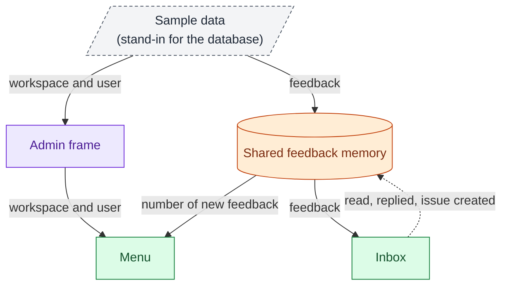

All feedback lives in one shared memory filled from sample data, so when the inbox changes a
feedback, the menu's count of new feedback updates at once.

Level 2

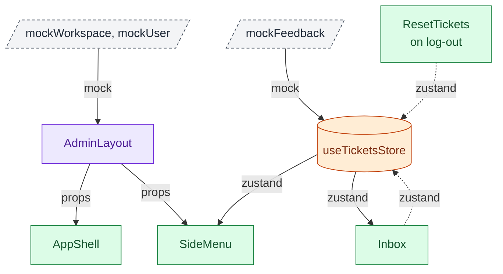

Level 3

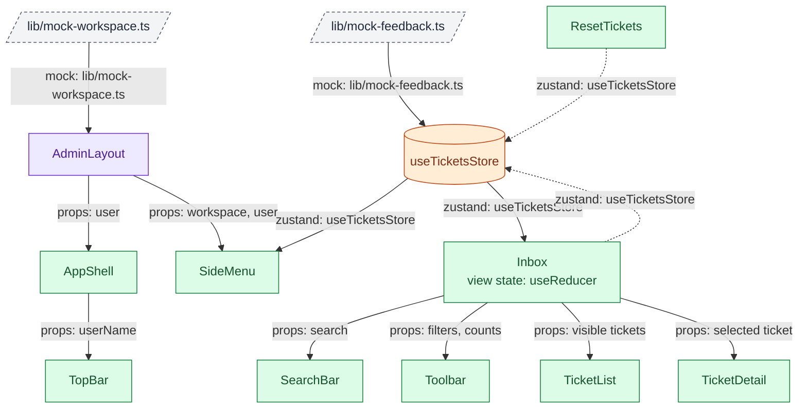

Level 4

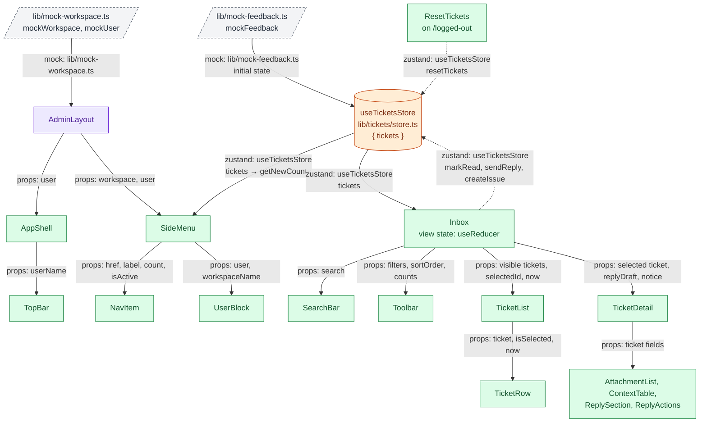

There are two data sources: `AdminLayout` is the only reader of the workspace and user mock and
passes them down as props, while ticket data lives in one Zustand store, `useTicketsStore`, which
is seeded from `mockFeedback` and read by both the side menu (unread counts) and the inbox, so
opening a ticket updates the menu count at once. All ticket changes go through the store's action
functions (`markRead`, `sendReply`, `createIssue`, `resetTickets`), which run the pure
`ticketsReducer` in `lib/tickets/state.ts`; `Inbox` calls them directly, and its children only
get callbacks from `Inbox`. Search, filters, sort order, the open ticket, the
reply draft and the notice are local `useReducer` state in `Inbox` (`lib/inbox/state.ts`), flow
down as props, and reset when the page is hidden; the highlighted menu item comes from the URL
(`usePathname`), not from any store.

Unclear in the code:

- `lib/mock-feedback.ts` says "Only app/page.tsx may import this (Constitution V)", but no
  `app/page.tsx` exists (the inbox is `app/(admin)/page.tsx`), and the actual importer is
  `lib/tickets/store.ts`. The comment looks stale; whether the store is the intended exception is
  not stated.
- The store has no persistence middleware, so a full page reload also brings back the mock data;
  the code only documents the explicit reset on `/logged-out`. Whether reload-resets are intended
  is not written down.
- The side menu shows unread counts per platform, but `/platforms/[platform]` does not read the
  store or filter tickets yet; it is a placeholder.

