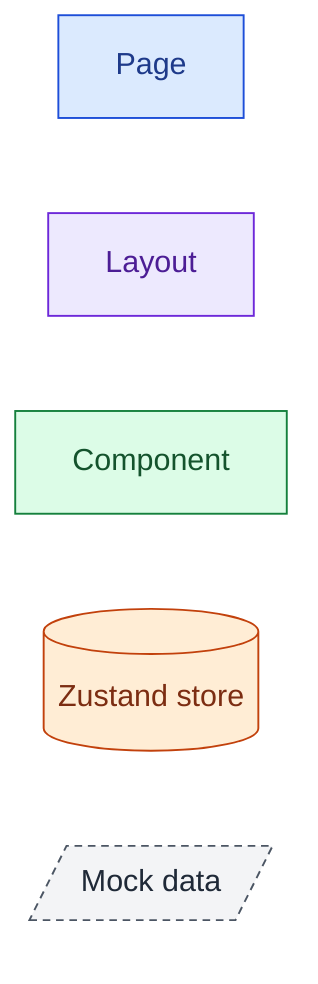
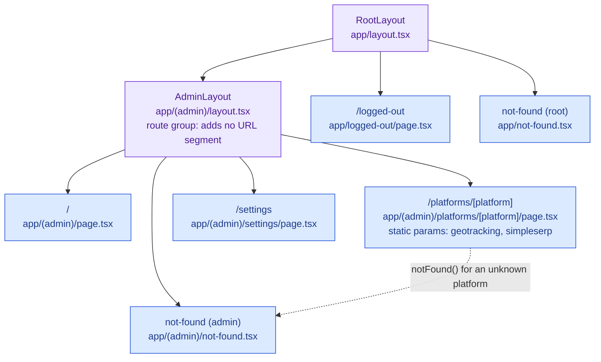
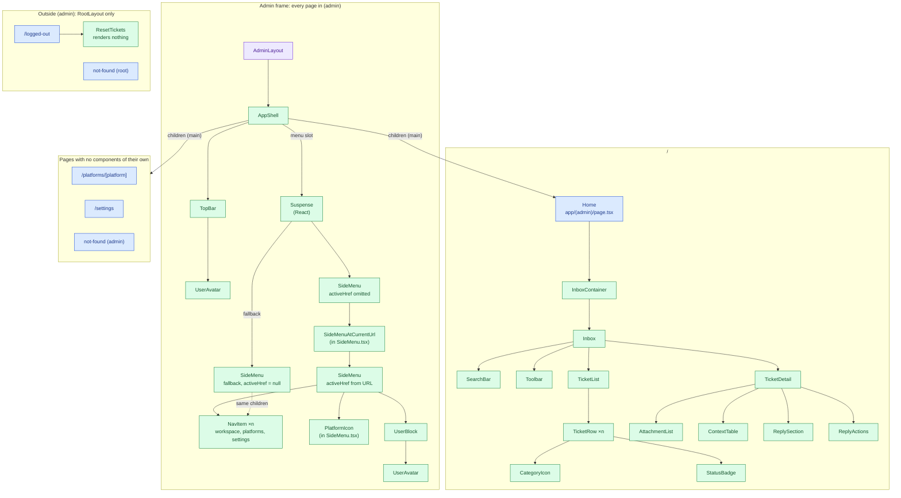
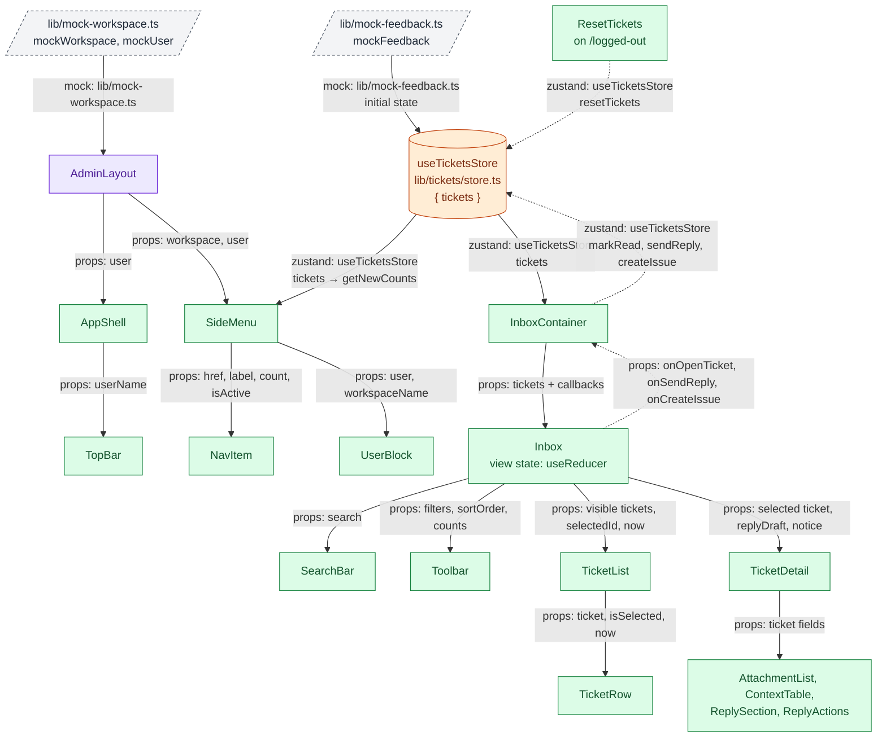

# Frontend architecture: apps/admin

An overview of the admin app as the code stands today: which pages exist, which components they
render, and where their data comes from. Everything here is read from the source; where the code
leaves something open, the text says so instead of filling the gap.

Keep this file in step with the code (see `CLAUDE.md` → Conventions).

## Legend

The same colours are used in all three diagrams.

| Category      | Colour            | What it is                                                         |
| ------------- | ----------------- | ------------------------------------------------------------------ |
| Page          | blue              | A `page.tsx` or `not-found.tsx` in `app/`                          |
| Layout        | purple            | A `layout.tsx` in `app/`                                           |
| Component     | green             | A React component in `components/` (or `next/react` built-in)      |
| Zustand store | orange            | A Zustand store in `lib/`                                          |
| Mock data     | grey, dashed edge | A mock-data module in `lib/` that stands in for the Convex backend |

In the data-flow diagram, solid arrows carry data down to where it is shown; dashed arrows carry
changes back up to the store.

## 1. Pages and routes

The `(admin)` route group decides whether a page gets the side menu: everything inside it is
wrapped by `AdminLayout` (and so by `AppShell` and `SideMenu`), while `/logged-out` and the root
not-found page sit directly under `RootLayout` with no menu. `/platforms/[platform]` builds only
`geotracking` and `simpleserp` and calls `notFound()` for anything else, which renders the admin
not-found page inside the menu; `/platforms/[platform]` and `/settings` are placeholders with a
heading only. Which not-found page an unmatched URL outside `/platforms/…` (e.g. `/foo`) gets is
left to Next.js routing: the code comments say the root one, but no test in this app checks it.

## 2. Component tree

Nesting is shown as parent → child. `Icon` (`components/Icons/Icon.tsx`) is left out to keep the
diagram readable; it is rendered by `AppShell`, `SideMenu` (and its inner `PlatformIcon`),
`UserBlock`, `UserAvatar`, `CategoryIcon`, `SearchBar`, `Toolbar`, `TicketRow`, `TicketDetail`,
`AttachmentList`, `ContextTable` and `ReplyActions`.

`SideMenu` renders itself up to three times: `AdminLayout` wraps it in `<Suspense>` because
`usePathname` can suspend on unknown platform URLs, so the fallback is the same menu with nothing
highlighted, and the real one hands off to `SideMenuAtCurrentUrl`, which reads the URL and renders
`SideMenu` again with `activeHref` set. The inbox is the only page with real UI; it is split into
`InboxContainer` (connects to the store) and `Inbox` (props only, plus its own view state), and
both `ReplySection` and `ReplyActions` are exported from the same file,
`components/inbox/ReplySection/ReplySection.tsx`. The placeholder pages and both not-found pages
render only HTML and `next/link`.

## 3. Data flow

There are two data sources: `AdminLayout` is the only reader of the workspace and user mock and
passes them down as props, while ticket data lives in one Zustand store, `useTicketsStore`, which
is seeded from `mockFeedback` and read by both the side menu (unread counts) and the inbox, so
opening a ticket updates the menu count at once. All ticket changes go through the store's action
functions (`markRead`, `sendReply`, `createIssue`, `resetTickets`), which run the pure
`ticketsReducer` in `lib/tickets/state.ts`; `Inbox` never touches the store itself but gets those
functions as callbacks from `InboxContainer`. Search, filters, sort order, the open ticket, the
reply draft and the notice are local `useReducer` state in `Inbox` (`lib/inbox/state.ts`), flow
down as props, and reset when the page is hidden; the highlighted menu item comes from the URL
(`usePathname`), not from any store.

Unclear in the code:

- `lib/mock-feedback.ts` says "Only app/page.tsx may import this (Constitution V)", but no
  `app/page.tsx` exists (the inbox is `app/(admin)/page.tsx`), and the actual importer is
  `lib/tickets/store.ts`. The comment looks stale; whether the store is the intended exception is
  not stated.
- The store has no persistence middleware, so a full page reload also brings back the mock data;
  the code only documents the explicit reset on `/logged-out`. Whether reload-resets are intended
  is not written down.
- The side menu shows unread counts per platform, but `/platforms/[platform]` does not read the
  store or filter tickets yet; it is a placeholder.
